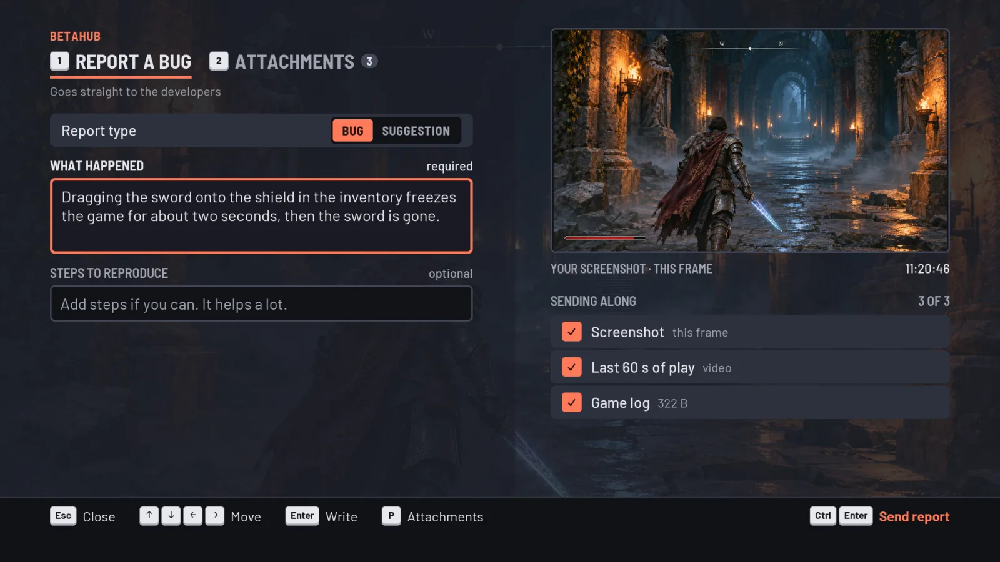
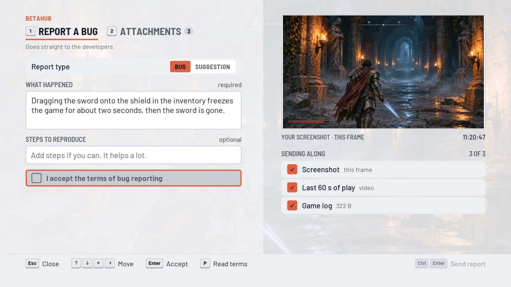

# BetaHub Unreal Plugin



> **Version 2.0 brings a new report form.** If it gives you trouble, you can switch back to the previous
> form in the project settings (see [The report form](#the-report-form)), or stay on
> [v1.7.1](https://github.com/betahub-io/unreal-plugin/releases/tag/v1.7.1), the last 1.x release.

## How it works

The plugin will start a *Background Service* that will record gameplay session as a video, including all the Unreal Engine logs. Then, it listens for the shortcut key (F12 by default) to open the bug reporter window. The user can then type in the bug description and submit it to the BetaHub platform.

## Installation

### From Fab

The plugin is available on the [Fab marketplace](https://www.fab.com/pl/listings/9c76232c-34f6-433c-ad7e-2c4005837e66). Install it directly from Fab into your Unreal Engine project.

### From GitHub

1. Navigate to your Unreal project directory.
2. Open the `Plugins` directory, or create it if it doesn't exist.
3. Unpack the contents of the GitHub repository into the `Plugins/BetaHubBugReporter` directory.
4. Restart Unreal Editor.
5. Confirm any prompts or warnings that may appear.

## Compatibility

This plugin is fully compatible with Unreal Engine versions **5.3**, **5.4**, **5.5**, **5.6**, **5.7**, and **5.8**. If you're looking for Unreal 4 support, there's a [separate repo for that](https://github.com/betahub-io/unreal-4-plugin).
All features have been tested and verified on these versions.

## FFmpeg Installation

The plugin requires FFmpeg for video recording. The plugin is built for Windows (Win64), and the GitHub
release includes FFmpeg at `Plugins/BetaHubBugReporter/ThirdParty/FFmpeg/Windows/ffmpeg.exe`; packaging
your game copies it next to the game as `bh_ffmpeg.exe` automatically. The Fab build has no FFmpeg: place
`ffmpeg.exe` in the plugin's `ThirdParty/FFmpeg/Windows/` folder, wherever the plugin is installed (with Fab,
in your engine's plugins folder), for the editor, and copy it into each packaged build as
`<PackagedGame>/<ProjectName>/Binaries/Win64/bh_ffmpeg.exe`, next to the packaged game. See
[FFMPEG_SETUP.md](FFMPEG_SETUP.md).

## Video Encoder

The plugin records by copying each frame off the GPU asynchronously, scaling it down on the GPU, and encoding it with the bundled FFmpeg (through an NVIDIA or AMD GPU's H.264 encoder when FFmpeg finds one, otherwise on the CPU). This is the only encoder in a standard build, and it works on every GPU — there is nothing to configure.

Frame capture never blocks the render thread waiting for the GPU, so recording costs a few percent of framerate rather than stalling every captured frame.

**Hardware (GPU) encoding — experimental, off by default.** An optional NVENC/AMF backend exists but is compiled out unless the plugin is built from source with the `BETAHUB_HWENCODE=1` environment variable set *and* Unreal's Experimental *AVCodecs* (plus *NVCodecs*/*AMFCodecs*) plugins enabled in your project. Only such a build shows the *Video Encoder Backend* setting under *Project Settings → Plugins → BetaHub Bug Reporter*, offering:

| Setting | What it does | Requirements |
| --- | --- | --- |
| **FFmpeg** (default) | Encodes with the bundled FFmpeg, through an NVIDIA or AMD GPU's H.264 encoder when it finds one, otherwise on the CPU. | None — works on every GPU. |
| **Hardware** | Encodes on the GPU (NVENC/AMF), keeping encoding off the CPU. | Windows, an NVIDIA or AMD GPU. |
| **Auto** | Uses the hardware encoder when it is available, otherwise FFmpeg. | Same as Hardware; silently uses FFmpeg when hardware isn't available. |

*Hardware* and *Auto* always fall back to FFmpeg if the GPU encoder can't start (no supported GPU, or the driver's encode-session limit is already used up by streaming software). The chosen backend is logged at the start of each recording under the `LogBetaHub` category.

The setting is hidden in standard builds because every option there would resolve to FFmpeg anyway.

## Configuration

Under *Project Settings → Plugins → BetaHub Bug Reporter*, set your Project ID (on your BetaHub project's
*General Settings* page) and Project Token (*Integrations → Auth Tokens*, starts with `tkn-`). There you can
also change the shortcut key that opens the report form. The settings land in `Config/DefaultGame.ini`:

```ini
[/Script/BetaHubBugReporter.BH_PluginSettings]
ProjectId=pr-0000000000
ProjectToken=tkn-your-token
```

For full docs and guides, please visit the [BetaHub Documentation](https://betahub.io/docs/permalinks/unreal-plugin).

## The report form

The form is a full-screen report screen over the game (which keeps running), played with a keyboard, a mouse or a
controller: what happened on the left, what gets sent along on the right, and every action in the prompt
bar at the bottom, shown with the glyphs of the device the player last used (keyboard, Xbox,
PlayStation or Switch). Players can switch between a bug report and a suggestion, leave out any
attachment, preview the screenshot, the last seconds of play and the game log full screen, and after
sending add an email to hear when the bug is fixed or copy a link to the report. The report and its
attachments are two tabs, switched with 1 and 2 on a keyboard or the shoulder buttons on a controller;
the arrow keys or the d-pad move between items, Tab and Shift+Tab go through them in order, and the
first prompt in the bar always goes back. Closing the form with a description, or a bug's steps, written
takes a second press, so a stray Esc does not lose a report.



Settings under *Project Settings → Plugins → BetaHub Bug Reporter → Report Widget*:

| Setting | What it does |
| --- | --- |
| **Theme** | One of six built-in colour themes (Dark by default). |
| **Theme Asset** | Your studio's colours instead: create a *BH_ThemeAsset* data asset with an accent colour, a neutral tint, a light or dark mode and a corner radius, and the form derives a full, contrast-checked theme from them. |
| **Require Terms Acceptance** / **Terms Url** | Players must accept your terms of bug reporting before they can send, and are told so if they try; *Read terms* opens the URL. |
| **Bug Min Length** / **Suggestion Min Length** | The shortest bug description and suggestion the form sends while it does not know your project's own minimums. The form reads those from BetaHub each time it opens and counts towards them next to the description's label; a player who tries to send a shorter one is told under the field how many characters are missing. A private project does not share them with a project token, so there these two apply: keep them at the project's minimum description lengths (BetaHub's defaults are 50 and 80), or BetaHub refuses shorter reports. A project that does not check descriptions takes a bug of any length: BetaHub tells the form 1; in a private one, set *Bug Min Length* to 1. When BetaHub does not give the minimums, a warning in the log says so once per session. |

The same in `DefaultGame.ini`; the built-in themes are `Dark`, `Light`, `Neutral`, `Ocean`, `Forest` and `Violet`:

```ini
[/Script/BetaHubBugReporter.BH_PluginSettings]
Theme=Ocean
bRequireTermsAcceptance=True
TermsUrl=https://example.com/bug-reporting-terms
BugMinLength=50
SuggestionMinLength=80
```

On Steam Deck and in Big Picture, a controller player who starts typing gets Steam's floating keyboard,
provided your game uses Steamworks; the plugin itself has no Steamworks dependency.

The form takes keyboard and controller input only when it captures the mouse
(`OpenReportForm(true)`, the default and what the shortcut key does). Opened with `false`, it leaves your
game's controls alone, as the previous form did.

The previous form is still included. To keep using it, pick *BugReportForm* for *Report Form Widget
Class*, or set it in `DefaultGame.ini`:

```ini
[/Script/BetaHubBugReporter.BH_PluginSettings]
ReportFormWidgetClass=/BetaHubBugReporter/BugReportForm.BugReportForm_C
```

C++ code that reaches into the previous form's widgets (`BugDescriptionEdit`, `SubmitButton` and the
rest) through the pointer `OpenReportForm` or `SpawnBugReportWidget` returns finds them null on the new
form: keep the previous form, or check them before use.

## Submission mode

The *Media Upload Mode* setting under *Project Settings → Plugins → BetaHub Bug Reporter* controls when
the report form confirms a submission and lets the player return to the game:

| Setting | What it does |
| --- | --- |
| **Upload in background** (default) | The form shows the report as sent as soon as the draft is created on BetaHub; the screenshot/video upload and the publish then finish in the background, under a small progress toast once the player is back in the game. The player is back in about one round-trip instead of waiting out the whole submission, which can take several seconds on projects with heavy server-side processing. |
| **Wait for upload** | The form stays open, showing each attachment's upload progress, until the media has fully uploaded. This was the behavior before 1.7. |

Background mode is safe against a lost connection: if the client's own publish call never lands (the game
is closed or crashes right after submitting), BetaHub auto-publishes the draft shortly afterwards, so a
report is never left stranded. **Updating from 1.6.x switches you to background mode automatically** — set
*Media Upload Mode* to *Wait for upload* if you want the old blocking behavior back:

```ini
[/Script/BetaHubBugReporter.BH_PluginSettings]
MediaUploadMode=WaitForUpload
```

## Using the plugin from C++

Add the plugin's module to your game module's `Build.cs`. The plugin builds for Win64 only, so a game that
also builds for other platforms adds it for Win64 and keeps its BetaHub code behind the same condition:

```csharp
if (Target.Platform == UnrealTargetPlatform.Win64)
{
    PrivateDependencyModuleNames.Add("BetaHubBugReporter");
    PublicDefinitions.Add("WITH_BETAHUB=1");
}
else
{
    PublicDefinitions.Add("WITH_BETAHUB=0");
}
```

```cpp
#if WITH_BETAHUB
#include "BH_GameInstanceSubsystem.h"
#endif
```

## Opening the form from your game

Players open the form with the shortcut key (F12 by default) during play, in your menus and while the
game is paused. The key only opens it; Esc (B on a controller) closes it. To open it from your own button,
a pause menu or a store screen, call *Open Report Form*
on the *BH Game Instance Subsystem*: in Blueprint through *Get BH Game Instance Subsystem*, in C++

```cpp
#include "BH_GameInstanceSubsystem.h"

// A "Report a bug" button in your pause menu
void UMyPauseMenu::OnReportBugClicked()
{
    if (UBH_GameInstanceSubsystem* BetaHub = UBH_GameInstanceSubsystem::Get(this))
    {
        BetaHub->OpenReportForm();
    }
}
```

It works with the shortcut turned off. The form opens above your menus; *Report Form Z Order* in the
plugin settings (10000 by default) sets its viewport layer. Opened with `true`, when it closes it gives
the game back the input mode it had (*Restore Input Mode: Auto*, the default), a menu's UI-only input and
focus included.

The plugin starts its recording service when the game starts. To start it yourself instead (for example
only in test builds), turn off *Spawn Background Service On Startup* and start a manager in your game
instance; the shortcut and *Open Report Form* then use it. One service runs per game instance: a second
one does not start (it logs a warning), and its *Spawn Bug Report Widget* opens the form through the first.

```cpp
#include "BH_Manager.h"

// UMyGameInstance.h
UPROPERTY()
TObjectPtr<UBH_Manager> BetaHubManager;

// UMyGameInstance.cpp
void UMyGameInstance::Init()
{
    Super::Init(); // the BetaHub subsystem exists only after this
    if (!IsDedicatedServerInstance())
    {
        BetaHubManager = NewObject<UBH_Manager>(this);
        BetaHubManager->StartService(this);
    }
}

void UMyGameInstance::Shutdown()
{
    if (BetaHubManager)
    {
        BetaHubManager->StopService();
    }
    Super::Shutdown();
}
```

A game that also builds for other platforms cannot put the `UPROPERTY` inside `#if WITH_BETAHUB` (Unreal's
header tool skips the block and the property loses its reflection, so the manager gets garbage-collected).
Declare it as `UPROPERTY() TObjectPtr<UObject> BetaHubManager;` instead, and keep the include and the calls in
the `.cpp` under `#if WITH_BETAHUB`, using `Cast<UBH_Manager>(BetaHubManager)`.

## Custom Fields

Attach your own game data (player level, current scene, build number) to every bug report sent from
the report form. Set it on the *BH Game Instance Subsystem*, from Blueprint or C++, and change it
whenever it changes:

```cpp
#include "BH_GameInstanceSubsystem.h"

if (UBH_GameInstanceSubsystem* BetaHub = UBH_GameInstanceSubsystem::Get(this))
{
    BetaHub->SetCustomField(TEXT("game_mode"), TEXT("ranked"));                     // text or single-select
    BetaHub->SetCustomField(TEXT("hardcore"), TEXT("1"));                          // boolean: "1" or "0"
    BetaHub->SetCustomFieldValues(TEXT("tags"), {TEXT("ui"), TEXT("inventory")});  // multi-select

    // Asked for its value each time a bug report is sent; skipped once this object is gone.
    BetaHub->RegisterCustomFieldProvider(TEXT("player_level"),
        FBH_CustomFieldProvider::CreateWeakLambda(this, [this]()
        {
            return FBH_CustomFieldValue::FromString(FString::FromInt(PlayerLevel));
        }));
}
```

A provider wins over a value set under the same name; a provider that returns an empty value leaves the
field out.

Blueprint has *Set Custom Field*, *Set Custom Field Values*, *Remove Custom Field*, and *Register Custom
Field Provider* / *Unregister Custom Field Provider*; bind a provider with a *Create Event* node to a
function that returns the value as a String. Custom fields go with bug reports, not with suggestions.
Field keys are snake_case identifiers.

In C++, `OnBuildCustomFields` gets the last word on every bug report's fields, after the set values and
the providers; a field left empty is then dropped. It sees the report's description:

```cpp
if (UBH_GameInstanceSubsystem* BetaHub = UBH_GameInstanceSubsystem::Get(this))
{
    BetaHub->OnBuildCustomFields.AddWeakLambda(this,
        [this](const FBH_CustomFieldContext& Report, FBH_CustomFieldMap& Fields)
        {
            Fields.Add(TEXT("map"), FBH_CustomFieldValue::FromString(GetWorld()->GetMapName()));
            // Network numbers only where a player reports lag.
            if (Report.Description.Contains(TEXT("lag")))
            {
                Fields.Add(TEXT("ping_ms"), FBH_CustomFieldValue::FromString(FString::FromInt(GetPingMs())));
            }
        });
}
```

**Project setup:** plain text fields auto-create on first submission, so no setup is needed for them. **Single-select, multi-select, and boolean fields must be pre-created** in your BetaHub project settings — and for select fields, every submitted value must match a predefined option, otherwise the whole report is rejected. See the [custom fields documentation](https://betahub.io/docs/integrations/game-engines/#custom-fields) for details.

Code that sends reports itself with `UBH_BugReport::SubmitReportWithMedia` passes its fields to it. The
subsystem's fields are not added on this path; `UBH_GameInstanceSubsystem::CustomFieldsFor` returns them,
to merge in:

```cpp
#include "BH_BugReport.h"

TMap<FString, FBH_CustomFieldValue> CustomFields;
CustomFields.Add(TEXT("player_level"), FBH_CustomFieldValue::FromString(FString::FromInt(PlayerLevel)));
CustomFields.Add(TEXT("tags"), FBH_CustomFieldValue::FromArray({TEXT("Bug"), TEXT("UI")})); // multi-select

UBH_BugReport* BugReport = NewObject<UBH_BugReport>();
UBH_PluginSettings* Settings = GetMutableDefault<UBH_PluginSettings>();
TArray<FBH_MediaFile> Videos, Screenshots, Logs;
BugReport->SubmitReportWithMedia(
    Settings, nullptr,
    TEXT("Description"), TEXT("Steps to reproduce"),
    Videos, Screenshots, Logs,
    []() {}, [](const FString& Error) {},
    TEXT(""), TEXT(""), CustomFields);
```

## Report modules

Data the plugin itself adds to bug reports, which you switch on or off. Each module offers rows in the
report form, and the player can leave a row out as any attachment. Suggestions take none, and the
previous form (*BugReportForm*) does not offer them.

| Module | On by default | What a bug report gets |
| --- | --- | --- |
| `hardware` | yes | How hard the machine worked in the seconds before the form opened, as long as the gameplay video (*Max Recording Duration*, 60 s): a summary in the custom field `performance` and every second in the file `betahub-performance-v1.json`; one row, *Performance*, takes or leaves out both. Row *Device* sends the machine (CPU, GPU, RAM, OS), which BetaHub adds as the report's device. |
| `network` | no | Ping times to BetaHub in the custom field `latency` (row *Network*), and the player's country and network provider in `country` and `asn` (row *Location*), as the Unity plugin's latency and geolocation providers send them. |

The fields are text fields, which BetaHub creates on the first report that has them. A report waits up to
10 seconds for the modules' data (only the location request takes time), then goes without a module that
has not answered.

**Switching modules**, each level winning over the one before it:

1. *Project Settings → Plugins → BetaHub Bug Reporter → Modules*: *Enable Hardware Module*, *Enable
   Network Module*, and the network module's options.
2. The command line, for a test run without a rebuild: `-BetaHubModules=hardware,network` runs exactly the
   modules named and no other, `-BetaHubModules=none` runs none.
3. The game: *Set Module Enabled* on the *BH Game Instance Subsystem*, for example only after the player
   agrees, or only in test builds. The choice lasts for the game instance, so set it again each session.
   *Is Module Enabled* tells whether a module is switched on.

```cpp
if (UBH_GameInstanceSubsystem* BetaHub = UBH_GameInstanceSubsystem::Get(this))
{
    BetaHub->SetModuleEnabled(TEXT("network"), bPlayerAgreed);
}
```

### Hardware

Sampled once a second on the game thread:

| Line in `performance` | Measured |
| --- | --- |
| PC | CPU and its threads, GPU, RAM, Windows version |
| FPS | Average frames per second, and the lowest of any second; the longest single frame |
| Frame time, avg | Game thread, render thread and GPU, as `stat unit` shows them; the GPU's peak, its slowest second |
| CPU | Load of the whole machine and the game's share of it, average and peak |
| VRAM | The game's video memory at its peak, and the budget Windows gives it |
| RAM | The game's memory at its peak; the free memory at its lowest |
| I/O | The game's reads and writes per second at their peak (files, and other I/O such as the network); free disk space |

CPU, VRAM and I/O are read from Windows.

```text
PC: AMD Ryzen 7 5800X (16 threads), NVIDIA GeForce RTX 3070, 32 GB RAM, Windows 11 (24H2) [10.0.26100.4061]
FPS: avg 58, min 31; longest frame 212 ms
Frame time, avg: game thread 12.1 ms, render thread 8.0 ms, GPU 14.2 ms (peak 31.0 ms)
CPU: machine avg 41%, peak 97%; game avg 22%, peak 35%
VRAM: game peak 5.8 GB of 7.2 GB budget
RAM: game peak 6.1 GB; free min 2.3 GB of 32 GB
I/O: game read peak 120 MB/s, write peak 15 MB/s; disk free 112 GB
Last 60 s before the report
```

The file, for BetaHub's view of a report, goes with the report's logs under the name
`betahub-performance-v1.json`. It has a row for about each second. A row's `seconds` is when its second
ended, counted back from the form opening, as the gameplay video ends when the form opens. A long hitch
stretches a row over more than a second, so line the rows up with the video by `seconds`, not by their order.
A value nobody could read is `null`. A new version of the format gets a new name.

```json
{
  "format": "betahub-performance",
  "version": 1,
  "sample_seconds": 1,
  "ends_at": "form_opened",
  "machine": {"cpu": "AMD Ryzen 7 5800X", "logical_cores": 16, "gpu": "NVIDIA GeForce RTX 3070", "ram_gb": 32, "os": "Windows 11 (24H2) [10.0.26100.4061]"},
  "columns": ["seconds", "fps", "frame_max_ms", "game_thread_ms", "render_thread_ms", "gpu_ms", "cpu_machine_pct", "cpu_game_pct", "ram_game_mb", "ram_free_mb", "vram_game_mb", "vram_budget_mb", "io_read_mb_s", "io_write_mb_s", "disk_free_gb"],
  "samples": [
    [-59.6, 58.1, 23.4, 11.2, 8.1, 13.4, 41, 23, 6100, 2410, 5210, 7300, 1.20, 0.20, 112.0],
    ...
    [-0.6, 57.9, 24.0, 11.0, 8.3, 15.1, 39, 24, 6140, 2380, 6120, 7300, 0.90, 0.10, 112.0]
  ]
}
```

The GPU's load in percent is not measured; its frame time shows how busy it is.

*Device* sends the PC line as `device_info`. After the report is saved, BetaHub adds the device it recognises
in it (CPU, GPU, memory, OS) as the report's device, the one its *Device* card and device filters show, unless
the project's Device field is disabled. Reading it never delays or refuses the report. Leaving *Device* out
does not keep the machine out of the report: *Performance* names it too.

### Network

When the report form opens, the module pings the *Ping Hosts* (`ping.betahub.io`) over ICMP: *Ping Count*
(10) rounds, each 0.1 s after the last one's answers (a ping waits up to 5 s), while the player writes; the
report takes the times measured so far. If every host fails three times in a row, it times requests to the
*Ping Http Endpoint* instead, as *Ping Method: HTTP* does from the start. With *Ping Continuously*, it pings
every *Ping Interval Seconds* (15) in the background, and the form adds the rounds a host still lacks to reach
*Ping Count* answers; the counts then run from the start of the game, and min/avg/max cover each host's
newest 256 times.

`latency` has a line per host pinged, for example:

```text
ping.betahub.io: min/avg/max = 18ms/24ms/41ms (9/10 requests), Lost: 1/10 (10.0%)
```

After a switch to HTTP, a second line for the endpoint follows `ping.betahub.io: latency unavailable`.

The player's country and network provider are asked from the *Ping Http Endpoint* only when a report is
sent with *Location* left in, read from its response headers, and kept for the session. *Send Country* and
*Send Network Provider* choose which of the two go. The options can be set while *Enable Network Module* is
off, for a game that switches the module on itself.

To switch the network module on for every player, with its options at their defaults:

```ini
[/Script/BetaHubBugReporter.BH_PluginSettings]
bEnableNetworkModule=True
PingMethod=ICMP
+PingHosts=ping.betahub.io
PingHttpEndpoint=https://ping.betahub.io/ping.txt
PingCount=10
bPingContinuously=False
PingIntervalSeconds=15
bSendCountry=True
bSendNetworkProvider=True
```

### Your own module (C++)

A module is a `UBH_ReportModule`: it runs while the BetaHub service runs, offers rows when the form
opens, and is asked for its data when a bug report is sent with one of its rows left in (always, if it
offers no rows).

```cpp
#include "BH_ReportModule.h"
#include "ServerStateModule.generated.h"

UCLASS()
class UServerStateModule : public UBH_ReportModule
{
    GENERATED_BODY()
public:
    virtual FName GetModuleId() const override { return TEXT("server"); }

    virtual void AddAttachments(TArray<FBH_ReportAttachment>& OutRows) const override
    {
        FBH_ReportAttachment Row;
        Row.Id = TEXT("server-state");                 // start with the module id
        Row.Name = FText::FromString(TEXT("Server"));
        Row.Meta = FText::FromString(TEXT("match state"));
        Row.Kind = EBH_AttachmentKind::Data;           // sent as custom fields, nothing to upload
        OutRows.Add(Row);
    }

    virtual void Collect(const TSet<FString>& IncludedRows, FBH_OnModuleCollected Done) override
    {
        FBH_ModuleContribution Data;
        Data.CustomFields.Add(TEXT("server_region"), FBH_CustomFieldValue::FromString(TEXT("eu-west")));
        Done(Data);   // once, within 10 seconds
    }
};

// Once the game instance is up:
BetaHub->RegisterModule(NewObject<UServerStateModule>(BetaHub));
```

A module of your own runs unless `SetModuleEnabled` switches it off or a `-BetaHubModules` list leaves it
out; override `IsEnabledByDefault` for one that starts off. *Start*, *Stop*, *OnFormOpened*, *OnFormClosed*
and *PreviewText* are there to override as well. A custom field your game sets itself wins
over a module's field of the same name.

## Getting Help

**Found a problem? Tell us on [Discord](https://discord.gg/g2wpRtG).** That's where our team is, and
it's the fastest way to get an answer.

It helps a lot if you include:

- your Unreal Engine version and platform,
- the plugin version (see `BetaHubBugReporter.uplugin`),
- the `LogBetaHub` lines from your project's `Saved/Logs/<Project>.log` — video recording in
  particular logs a clear reason when it can't record.

### Workaround: roll back to a previous release

If a new release breaks something for you, install the previous one from
[GitHub Releases](https://github.com/betahub-io/unreal-plugin/releases) while we sort it out. Each
release is packaged per engine version, so pick the zip matching your engine (for example
`BetaHubPlugin-<version>-Unreal_5.4.zip`). Replace the contents of
`Plugins/BetaHubBugReporter` with the older build and restart the editor.

Please still let us know on Discord that you had to roll back, and which version works — that tells
us what broke and when.

`master` is the maintained branch: it carries every released fix, and each release is built and
tested against all supported engine versions before it ships.
