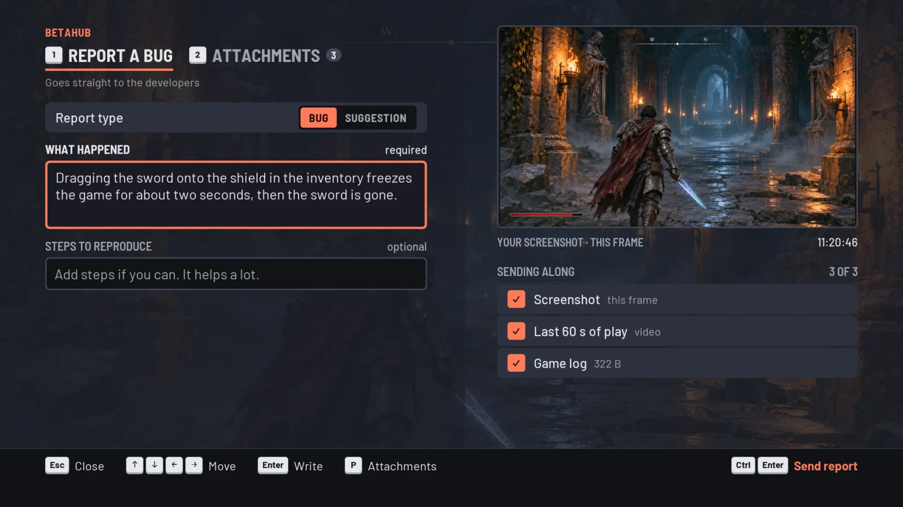
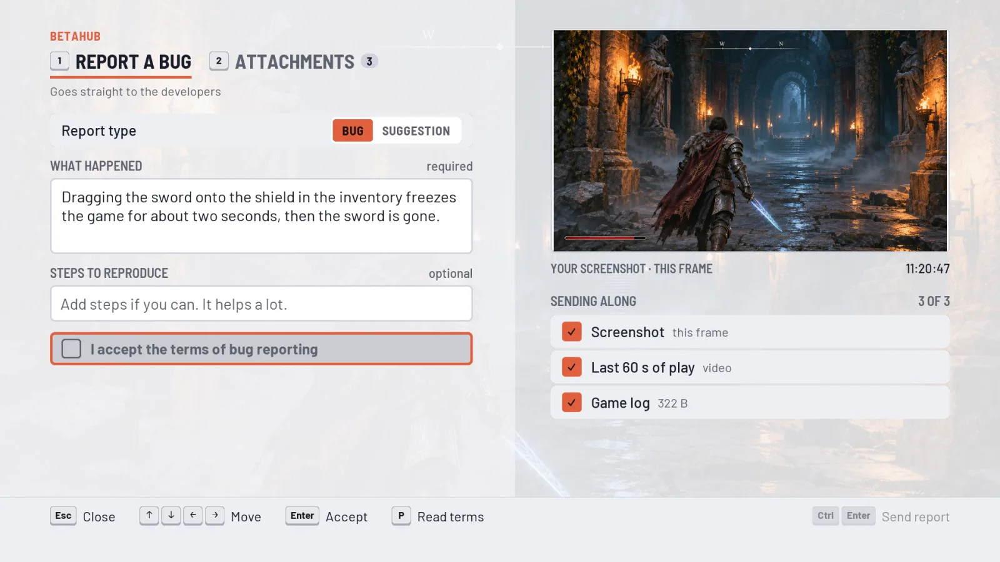

# BetaHub Unreal Plugin



> **Version 2.0 brings a new report form.** If it gives you trouble, you can switch back to the previous
> form in the project settings (see [The report form](#the-report-form)), or stay on
> [v1.7.1](https://github.com/betahub-io/unreal-plugin/releases/tag/v1.7.1), the last 1.x release.

## How it works

The plugin will start a *Background Service* that will record gameplay session as a video, including all the Unreal Engine logs. Then, it listens for the shortcut key (F12 by default) to open the bug reporter window. The user can then type in the bug description and submit it to the BetaHub platform.

## Installation

### From Fab

The plugin is available on the [Fab marketplace](https://www.fab.com/pl/listings/9c76232c-34f6-433c-ad7e-2c4005837e66). Install it directly from Fab into your Unreal Engine project.

### From GitHub

1. Navigate to your Unreal project directory.
2. Open the `Plugins` directory, or create it if it doesn't exist.
3. Unpack the contents of the GitHub repository into the `Plugins/BetaHubBugReporter` directory.
4. Restart Unreal Editor.
5. Confirm any prompts or warnings that may appear.

## Compatibility

This plugin is fully compatible with Unreal Engine versions **5.3**, **5.4**, **5.5**, **5.6**, **5.7**, and **5.8**. If you're looking for Unreal 4 support, there's a [separate repo for that](https://github.com/betahub-io/unreal-4-plugin).
All features have been tested and verified on these versions.

## FFmpeg Installation

The plugin requires FFmpeg for video recording. Place the FFmpeg executable in the following location based on your platform:

- **Windows:** `Plugins/BetaHubBugReporter/ThirdParty/FFmpeg/Windows/ffmpeg.exe`
- **Mac:** `Plugins/BetaHubBugReporter/ThirdParty/FFmpeg/Mac/ffmpeg`
- **Linux:** `Plugins/BetaHubBugReporter/ThirdParty/FFmpeg/Linux/ffmpeg`

For packaged builds, place the executable (renamed to `bh_ffmpeg` or `bh_ffmpeg.exe`) in `Binaries/<Platform>/`.

## Video Encoder

The plugin records by copying each frame off the GPU asynchronously, scaling it down on the GPU, and encoding it with the bundled FFmpeg (CPU). This is the only encoder in a standard build, and it works on every GPU and platform — there is nothing to configure.

Frame capture never blocks the render thread waiting for the GPU, so recording costs a few percent of framerate rather than stalling every captured frame.

**Hardware (GPU) encoding — experimental, off by default.** An optional NVENC/AMF backend exists but is compiled out unless the plugin is built from source with the `BETAHUB_HWENCODE=1` environment variable set *and* Unreal's Experimental *AVCodecs* (plus *NVCodecs*/*AMFCodecs*) plugins enabled in your project. Only such a build shows the *Video Encoder Backend* setting under *Project Settings → Plugins → BetaHub Bug Reporter*, offering:

| Setting | What it does | Requirements |
| --- | --- | --- |
| **FFmpeg** (default) | Encodes on the CPU with the bundled FFmpeg. | None — works on every GPU and platform. |
| **Hardware** | Encodes on the GPU (NVENC/AMF), keeping encoding off the CPU. | Windows, an NVIDIA or AMD GPU. |
| **Auto** | Uses the hardware encoder when it is available, otherwise FFmpeg. | Same as Hardware; silently uses FFmpeg when hardware isn't available. |

*Hardware* and *Auto* always fall back to FFmpeg if the GPU encoder can't start (no supported GPU, or the driver's encode-session limit is already used up by streaming software). The chosen backend is logged at the start of each recording under the `LogBetaHub` category.

The setting is hidden in standard builds because every option there would resolve to FFmpeg anyway.

## Configuration

Under *Project Settings → Plugins → BetaHub Bug Reporter*, set your Project ID (on your BetaHub project's
*General Settings* page) and Project Token (*Integrations → Auth Tokens*, starts with `tkn-`). There you can
also change the shortcut key that opens the report form. The settings land in `Config/DefaultGame.ini`:

```ini
[/Script/BetaHubBugReporter.BH_PluginSettings]
ProjectId=pr-0000000000
ProjectToken=tkn-your-token
```

For full docs and guides, please visit the [BetaHub Documentation](https://betahub.io/docs/permalinks/unreal-plugin).

## The report form

The form is a full-screen report screen over the game (which keeps running), played with a keyboard, a mouse or a
controller: what happened on the left, what gets sent along on the right, and every action in the prompt
bar at the bottom, shown with the glyphs of the device the player last used (keyboard, Xbox,
PlayStation or Switch). Players can switch between a bug report and a suggestion, leave out any
attachment, preview the screenshot, the last seconds of play and the game log full screen, and after
sending add an email to hear when the bug is fixed or copy a link to the report. The report and its
attachments are two tabs, switched with 1 and 2 on a keyboard or the shoulder buttons on a controller;
the arrow keys or the d-pad move between items, Tab and Shift+Tab go through them in order, and the
first prompt in the bar always goes back.



Settings under *Project Settings → Plugins → BetaHub Bug Reporter → Report Widget*:

| Setting | What it does |
| --- | --- |
| **Theme** | One of six built-in colour themes (Dark by default). |
| **Theme Asset** | Your studio's colours instead: create a *BH_ThemeAsset* data asset with an accent colour and a neutral tint, and the form derives a full, contrast-checked theme from them. |
| **Require Terms Acceptance** / **Terms Url** | Players must accept your terms of bug reporting before they can send; *Read terms* opens the URL. |
| **Suggestion Min Length** | The shortest suggestion the form sends. Keep it at your BetaHub project's minimum description length (80 unless changed there), or BetaHub refuses the suggestion. |

The same in `DefaultGame.ini`; the built-in themes are `Dark`, `Light`, `Neutral`, `Ocean`, `Forest` and `Violet`:

```ini
[/Script/BetaHubBugReporter.BH_PluginSettings]
Theme=Ocean
bRequireTermsAcceptance=True
TermsUrl=https://example.com/bug-reporting-terms
SuggestionMinLength=80
```

On Steam Deck and in Big Picture, a controller player who starts typing gets Steam's floating keyboard,
provided your game uses Steamworks; the plugin itself has no Steamworks dependency.

The form takes keyboard and controller input only when it captures the mouse
(`SpawnBugReportWidget(true)`, which the shortcut key uses). Opened with `false`, it leaves your game's
controls alone, as the previous form did.

The previous form is still included. To keep using it, pick *BugReportForm* for *Report Form Widget
Class*, or set it in `DefaultGame.ini`:

```ini
[/Script/BetaHubBugReporter.BH_PluginSettings]
ReportFormWidgetClass=/BetaHubBugReporter/BugReportForm.BugReportForm_C
```

C++ code that reaches into the previous form's widgets (`BugDescriptionEdit`, `SubmitButton` and the
rest) through the pointer `SpawnBugReportWidget` returns finds them null on the new form: keep the
previous form, or check them before use.

## Submission mode

The *Media Upload Mode* setting under *Project Settings → Plugins → BetaHub Bug Reporter* controls when
the report form confirms a submission and lets the player return to the game:

| Setting | What it does |
| --- | --- |
| **Upload in background** (default) | The form shows the report as sent as soon as the draft is created on BetaHub; the screenshot/video upload and the publish then finish in the background, under a small progress toast once the player is back in the game. The player is back in about one round-trip instead of waiting out the whole submission, which can take several seconds on projects with heavy server-side processing. |
| **Wait for upload** | The form stays open, showing each attachment's upload progress, until the media has fully uploaded. This was the behavior before 1.7. |

Background mode is safe against a lost connection: if the client's own publish call never lands (the game
is closed or crashes right after submitting), BetaHub auto-publishes the draft shortly afterwards, so a
report is never left stranded. **Updating from 1.6.x switches you to background mode automatically** — set
*Media Upload Mode* to *Wait for upload* if you want the old blocking behavior back:

```ini
[/Script/BetaHubBugReporter.BH_PluginSettings]
MediaUploadMode=WaitForUpload
```

## Using the plugin from C++

Add the plugin's module to your game module's `Build.cs`. Its headers include UMG's, so add UMG too:

```csharp
PrivateDependencyModuleNames.AddRange(new string[] { "BetaHubBugReporter", "UMG" });
```

## Opening the form from your game

Players open the form with the shortcut key (F12 by default) during play, in your menus and while the
game is paused. To open it from your own button, a pause menu or a store screen, call *Open Report Form*
on the *BH Game Instance Subsystem*: in Blueprint through *Get BH Game Instance Subsystem*, in C++

```cpp
#include "BH_GameInstanceSubsystem.h"

// A "Report a bug" button in your pause menu
void UMyPauseMenu::OnReportBugClicked()
{
    if (UBH_GameInstanceSubsystem* BetaHub = UBH_GameInstanceSubsystem::Get(this))
    {
        BetaHub->OpenReportForm();
    }
}
```

It works with the shortcut turned off. The form opens above your menus; *Report Form Z Order* in the
plugin settings (10000 by default) sets its viewport layer.

The plugin starts its recording service when the game starts. To start it yourself instead (for example
only in test builds), turn off *Spawn Background Service On Startup* and start a manager in your game
instance; the shortcut and *Open Report Form* then use it:

```cpp
#include "BH_Manager.h"

// UMyGameInstance.h
UPROPERTY()
TObjectPtr<UBH_Manager> BetaHubManager;

// UMyGameInstance.cpp
void UMyGameInstance::Init()
{
    Super::Init();
    BetaHubManager = NewObject<UBH_Manager>(this);
    BetaHubManager->StartService(this);
}

void UMyGameInstance::Shutdown()
{
    BetaHubManager->StopService();
    Super::Shutdown();
}
```

## Custom Fields

Attach your own game data (player level, current scene, build number) to every bug report sent from
the report form. Set it on the *BH Game Instance Subsystem*, from Blueprint or C++, and change it
whenever it changes:

```cpp
#include "BH_GameInstanceSubsystem.h"

UBH_GameInstanceSubsystem* BetaHub = UBH_GameInstanceSubsystem::Get(this);
BetaHub->SetCustomField(TEXT("game_mode"), TEXT("ranked"));                     // text or single-select
BetaHub->SetCustomField(TEXT("hardcore"), TEXT("1"));                          // boolean: "1" or "0"
BetaHub->SetCustomFieldValues(TEXT("tags"), {TEXT("ui"), TEXT("inventory")});  // multi-select

// Asked for its value each time a report is sent; skipped once this object is gone.
BetaHub->RegisterCustomFieldProvider(TEXT("player_level"),
    FBH_CustomFieldProvider::CreateWeakLambda(this, [this]()
    {
        return FBH_CustomFieldValue::FromString(FString::FromInt(PlayerLevel));
    }));
```

Blueprint has *Set Custom Field*, *Set Custom Field Values*, *Remove Custom Field* and *Register Custom
Field Provider* (an event that returns the value). Custom fields go with bug reports, not with
suggestions. Field keys are snake_case identifiers.

In C++, `OnBuildCustomFields` gets the last word on every report's fields, after the set values and the
providers. It sees what the report is about:

```cpp
BetaHub->OnBuildCustomFields.AddWeakLambda(this,
    [this](const FBH_CustomFieldContext& Report, FBH_CustomFieldMap& Fields)
    {
        Fields.Add(TEXT("map"), FBH_CustomFieldValue::FromString(GetWorld()->GetMapName()));
        // Network numbers only where a player reports lag.
        if (Report.Description.Contains(TEXT("lag")))
        {
            Fields.Add(TEXT("ping_ms"), FBH_CustomFieldValue::FromString(FString::FromInt(GetPingMs())));
        }
    });
```

**Project setup:** plain text fields auto-create on first submission, so no setup is needed for them. **Single-select, multi-select, and boolean fields must be pre-created** in your BetaHub project settings — and for select fields, every submitted value must match a predefined option, otherwise the whole report is rejected. See the [custom fields documentation](https://betahub.io/docs/integrations/game-engines/#custom-fields) for details.

Code that sends reports itself with `UBH_BugReport::SubmitReportWithMedia` passes its fields to it:

```cpp
TMap<FString, FBH_CustomFieldValue> CustomFields;
CustomFields.Add("player_level", FBH_CustomFieldValue::FromString(FString::FromInt(PlayerLevel)));
CustomFields.Add("tags", FBH_CustomFieldValue::FromArray({ "Bug", "UI" })); // multi-select

BugReport->SubmitReportWithMedia(
    Settings, nullptr,
    TEXT("Description"), TEXT("Steps to reproduce"),
    Videos, Screenshots, Logs,
    []() {}, [](const FString& Error) {},
    TEXT(""), TEXT(""), CustomFields);
```

## Getting Help

**Found a problem? Tell us on [Discord](https://discord.gg/g2wpRtG).** That's where our team is, and
it's the fastest way to get an answer.

It helps a lot if you include:

- your Unreal Engine version and platform,
- the plugin version (see `BetaHubBugReporter.uplugin`),
- the `LogBetaHub` lines from your project's `Saved/Logs/<Project>.log` — video recording in
  particular logs a clear reason when it can't record.

### Workaround: roll back to a previous release

If a new release breaks something for you, install the previous one from
[GitHub Releases](https://github.com/betahub-io/unreal-plugin/releases) while we sort it out. Each
release is packaged per engine version, so pick the zip matching your engine (for example
`BetaHubPlugin-<version>-Unreal_5.4.zip`). Replace the contents of
`Plugins/BetaHubBugReporter` with the older build and restart the editor.

Please still let us know on Discord that you had to roll back, and which version works — that tells
us what broke and when.

`master` is the maintained branch: it carries every released fix, and each release is built and
tested against all supported engine versions before it ships.
